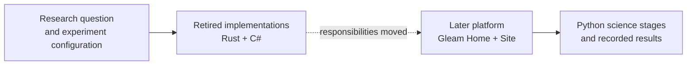

# Fern: experiments, execution, and the systems behind them

**A research system has to do more than train a model.** It has to keep a
declared experiment connected to the machine that ran it and to the result a
researcher accepts. This archive preserves the retired C# and Rust parts of
Fern's research infrastructure: experiment authoring, scheduling, registry
state, workers, and their tests.

**Archive status:** the C# and Rust implementations were retired on
2026-09-28 and are not maintained. This is a historical code archive, not a
drop-in copy of the current Fern platform.



### A failure worth reading: a replaced supervisor

A machine can lose its lease and a replacement supervisor can take over. What
stops the old supervisor from starting work as if it still held that lease?
The archived registry uses a **fencing epoch**: an attempt carrying an expired,
replaced, or ended supervisor's epoch is refused; a claim with the current
epoch can proceed. The same test also records a compatibility boundary:
claims that name no epoch are handled as before.

[Read the supervisor test](csharp/src/csharp/Fern.Registry.Tests/SupervisorOfficeTests.cs)
· [Read the scheduler decision](csharp/src/csharp/Fern.Scheduler/SchedulerDecision.cs)
· [Read the registry access code](csharp/src/csharp/Fern.Registry/RegistryAccess.cs)

The test is evidence of the behavior it exercises; it is not a claim that every
possible stale write or distributed failure was tested.

### See a study run through the later platform

<a href="https://github.com/QilinWang/QilinWang/blob/main/showcase/fern-experiment-system.md">
  
</a>

**2 of 2 cells accepted** in one documented study. Follow its configuration,
registration, execution and result records in the [experiment-system case
study](https://github.com/QilinWang/QilinWang/blob/main/showcase/fern-experiment-system.md).
That study used the **later Gleam Home / Site and Python platform**, not the
retired C# and Rust implementation in this archive. Acceptance records an
execution and result state; it is not by itself a scientific conclusion or a
public one-command reproduction.

### My contribution and AI collaboration

I developed Fern's original model and training code. For the later experiment
platform, I directed research priorities and approved scientific settings,
worked through scheduling and resource-management failures, and worked with AI
coding agents to build and harden the system. Claude Code and Codex contributed
to broader platform work; for the linked study, Claude Opus 5.5 prepared the
study cards and coordinated registration under my scientific and scheduling
direction. These roles do not imply that I hand-wrote every archived component
or that an agent independently chose the scientific settings.

### Test snapshot

**Privacy update:** selected historical research configurations, research-derived
fixtures and an implementation bundle were removed from this public archive.
The identified Rust tests that require those artifacts are marked ignored;
other indirect dependencies have not all been ruled out. The figures below were
recorded **before** that removal; they are not a fresh test of this version.

In one recorded run on the archive export, the C# Registry suite passed
**337 / 337** tests; the C# Scheduler suite passed **507 / 619**. The 112
remaining Scheduler tests reported a missing Gleam shipment entrypoint. Other
Rust suites also have recorded missing dependencies; the full table and build
conditions are [below](#test-status). These are historical results, not a claim
of current CI or a fresh run.

**Status: retired on 2026-09-28 and not maintained.** This code is published as
an archive with research artifacts omitted. No issue will be fixed and no pull
request will be merged. The later system uses Gleam Home and Scheduler with a
Gleam Site Node executing Python science stages.

## What is inside

| Directory | What it is                                                                                                                          |
| --------- | ----------------------------------------------------------------------------------------------------------------------------------- |
| `csharp/` | retired C# source at its historical paths, including the registry and scheduler with tests; selected research artifacts are omitted |
| `rust/`   | retired Rust source with `Cargo.toml`, `Cargo.lock`, 13 crates and four workspace members; selected research fixtures are omitted   |

The C# tree keeps its original layout, so the solution is
`csharp/src/csharp/Fern.sln` and project references stay relative to it.

## Build

```sh
cd csharp/src/csharp && dotnet build Fern.sln     # .NET 11 preview SDK, pinned in csharp/global.json
cd rust && cargo build --workspace               # Rust 1.97, dependencies pinned in Cargo.lock
```

Measured on a clean export before the privacy update: the C# solution built in about 20 s with 0 errors
and 4 warnings, and the Rust workspace in about 37 s with 0 errors. The four C#
warnings come from `Fern.BuildIdentity.targets`, which asks git for a commit
hash; outside a checkout of the original repository it reports the missing
identity and nothing else.

## Test status

The numbers below are from one run on the original export, before the privacy
update. Some suites then needed sibling trees that were not part of the archive;
other historical research fixtures have since been removed as described above.
The full suites have not been rerun on this redacted version.

| Suite                            | Result          | What it needs that this repository does not contain                                      |
| -------------------------------- | --------------- | ---------------------------------------------------------------------------------------- |
| C# `Fern.Registry.Tests`         | 337 of 337 pass | nothing                                                                                  |
| C# `Fern.Scheduler.Tests`        | 507 of 619 pass | the built Gleam scheduler shipment (112 tests report `no Gleam shipment entrypoint`)     |
| Rust `fern-experiment-types`     | 41 of 41 pass   | nothing                                                                                  |
| Rust `fern-json-contract`        | 5 of 5 pass     | nothing                                                                                  |
| Rust `fern-recipes`              | 25 of 26 pass   | `fr_core.py`, the reviewed Python worker source                                          |
| Rust `fern-experiment-authoring` | 5 of 44 pass    | the C# `fern-experiment` command-line binary, built at the path it had before retirement |

```sh
cd csharp/src/csharp && dotnet test Fern.sln
cd rust && cargo test --workspace --no-fail-fast
```

## Running the commands

On the historical export, both command-line entrances started and parsed their
arguments; they then needed the registry or configuration that lived outside
this repository. These commands have not been rechecked after the privacy update.

```sh
dotnet run --project csharp/src/csharp/Fern.Registry.Cli -- --help
cargo run -p fern-experiment-authoring --bin fern-experiment -- --help
```

## What replaced what

| Old responsibility                                                                        | Current owner                                          |
| ----------------------------------------------------------------------------------------- | ------------------------------------------------------ |
| Registry scheduling, study and source registration, queue, retries, site terms and claims | Gleam Home and Scheduler                               |
| C# `RunStudyCells` to `ResidentWorkerHost` to `fern-site` phase RPC                       | Gleam Site Node cells, stage calls, Python stages      |
| Human views, actions and results                                                          | Gleam CLI, Home, Lustre Dashboard; Python result store |
| Artifact hold, GC, location and relocation (six `RegistryCli` verbs)                      | retired with no replacement; it had no current caller  |
| Provider lifecycle, runtime selection and the .NET set installer                          | Gleam Home machine install, start and check            |
| CI, release and nightly                                                                   | Gleam packages and bundled OTP releases                |

The full boundary table, with the evidence and the limit of each line, is the
retirement inventory in the Fern repository
(`docs/programs/2026-09-28-retire-csharp-owners/retirement-inventory.md`).

## Why it is published

The same system exists in three implementations: Rust, then C#, then Gleam. The
C# one is the largest and the heaviest, and it is the one that was retired
wholesale. Publishing it makes that decision checkable instead of merely
described: the source is here, the table above says what each part became, and
the Fern repository records how the export was assembled and what was removed.

Two details show what the repository was: [`csharp/src/csharp/Fern.Experiment/SerdeJson.cs`](csharp/src/csharp/Fern.Experiment/SerdeJson.cs)
contains an implementation intended to match Rust `serde_json::Value` bytes
for a configuration identity preimage, including sorted object keys; and
`rust/crates/fern-recipes/src/dataset_catalog.rs` embeds a dataset catalogue
that lived in the C# tree, so the two implementations were built against each
other.

## What this is not

It is not a migration path: the old SQLite state was never migrated, and no
import tool is provided. It is not a compatibility layer for current Fern. It is
not built by CI. The original Git hosting workflows are not included, because
the nightly job required a self-hosted GPU machine that no longer exists.

## Licence

MIT. See `LICENSE`.
